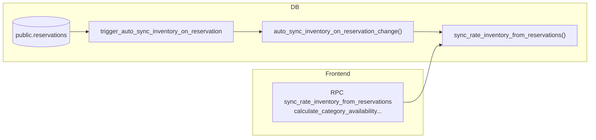
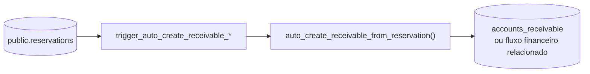

# Fluxos críticos (E2E) — derivado dos inventários

Documento **manual** que liga entidades reutilizadas pelo PMS. Os nomes citam objetos listados em [triggers-inventory.md](./triggers-inventory.md), [sql-rpc-inventory.md](./sql-rpc-inventory.md), [edge-functions-inventory.md](./edge-functions-inventory.md) e [frontend-rpc-inventory.md](./frontend-rpc-inventory.md).

## 1. Reserva + inventário ARI + UI

O frontend chama RPCs como `calculate_category_availability`, `is_date_available_for_sale`, `sync_rate_inventory_from_reservations` e `create_reservation_with_lock` ([frontend-rpc-inventory](./frontend-rpc-inventory.md)).

Em base de dados, alterações em `public.reservations` disparam `trigger_auto_sync_inventory_on_reservation`, que executa `public.auto_sync_inventory_on_reservation_change()` e por sua vez `public.sync_rate_inventory_from_reservations(...)` ([triggers-inventory](./triggers-inventory.md) — secção `public.reservations`). Alterações em `public.rooms` usam `trigger_auto_sync_inventory_on_room` / `auto_sync_inventory_on_room_change()`.

**Teste manual sugerido:** criar ou alterar uma reserva (datas/categoria/status) e confirmar que o grelha ARI / disponibilidade reflete o esperado; ver também [cloud-validation.md](./cloud-validation.md) para queries de conferência.

## 2. Reserva + financeiro (contas a receber)

Triggers `trigger_auto_create_receivable_on_reservation_insert` e `..._update` em `public.reservations` chamam `auto_create_receivable_from_reservation()` ([triggers-inventory](./triggers-inventory.md)).

## 3. Reserva + preço dinâmico

Em `public.reservations`: `trg_reservation_insert_dynamic_pricing` e `trg_reservation_update_cancelled_dynamic_pricing` ([triggers-inventory](./triggers-inventory.md)).

## 4. Stripe (pagamento na app → confirmação)

- Frontend: `stripe-payment`, `stripe-payment-status` (Edge, JWT desactivado no gateway — [edge-functions-inventory](./edge-functions-inventory.md)); `stripe-refund` com JWT.
- Stripe Dashboard envia eventos para Edge `stripe-webhook` (`verify_jwt = false`; assinatura Stripe).
- `public.stripe_payments` e triggers de `updated_at` estão em [triggers-inventory](./triggers-inventory.md).

## 5. Integrações OTA (Channex / Aiosell)

- Webhooks públicos: `channex-reservation-webhook`, `aiosell-reservation-webhook` (`verify_jwt = false`).
- Sincronização com JWT: `channex-reservations-sync`, `aiosell-reservations-sync`, etc.
- RPC típico em cadeia: `ota_link_reservation_after_sync`, `create_reservation_with_lock` (Edge + SQL).

## 6. Fila de e-mail

- Tabela `public.email_queue`: políticas em [rls-policies-inventory](./rls-policies-inventory.md); trigger `email_queue_to_logs` em [triggers-inventory](./triggers-inventory.md).
- Função `insert_email_queue` com `GRANT` amplo em [sql-rpc-inventory](./sql-rpc-inventory.md).

---

Este ficheiro não é gerado automaticamente: actualize quando adicionar fluxos ou quando a validação na cloud mostrar divergências em relação às migrações.
