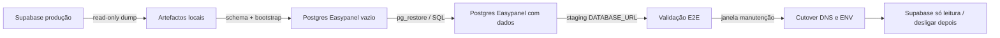

# Auditoria Supabase e plano de descontinuação (StayOS)

**Data de referência:** preparação para PostgreSQL no Easypanel.  
**Corte definitivo:** não executar até aprovação explícita e checklist verde.

---

## Etapa 1 — Diagnóstico das dependências

### Resumo executivo

| Camada Supabase | Uso real hoje | Substituto já no projeto | Ação na migração |
| --- | --- | --- | --- |
| **PostgreSQL** | `DATABASE_URL` → pooler Supabase | Postgres próprio (Easypanel) | Dump/restore; trocar `DATABASE_URL` |
| **Auth (GoTrue)** | Legado em `auth.users` / senhas bcrypt | **Nest JWT** + `nestClient` auth | Dados: dump `auth.*`; runtime: **não** chama supabase.co |
| **API de dados** | PostgREST | **Nest** `/rest/v1/query` | Front usa cliente compatível; sem Supabase |
| **Edge Functions** | ~40 funções Deno | **Nest** `/functions/v1/*` | Desligar crons Supabase após worker BullMQ |
| **Storage** | Buckets na cloud | **Nest** `StorageService` → `STORAGE_DIR` / volume | Copiar ficheiros para volume do backend |
| **Realtime** | Canais Postgres | **Socket.IO** `RealtimeGateway` | Sem Supabase Realtime |
| **SDK browser** | `@supabase/supabase-js` | `createNestSupabase()` → API Nest | `VITE_SUPABASE_*` podem ficar vazios |
| **RLS / roles** | `anon`, `authenticated`, `service_role` | `SET LOCAL ROLE` no DataService | `bootstrap-target-postgres.sql` no destino |

Documentação de inventário existente: [overview.md](./overview.md).

---

### 1. PostgreSQL

- **Conexão:** `DATABASE_URL` no backend, worker e scripts de dump (`SOURCE_DATABASE_URL` / `TARGET_DATABASE_URL`).
- **Schema:** definido em `supabase/migrations/*.sql` + migrações Prisma Nest (`backend/prisma/migrations`, ex. `backend_healthchecks`).
- **RLS:** políticas no Postgres; o Nest emula JWT claims (`request.jwt.claim.sub`) — ver [rls-policies-inventory.md](./rls-policies-inventory.md).
- **Triggers/functions:** ver [triggers-inventory.md](./triggers-inventory.md), [sql-rpc-inventory.md](./sql-rpc-inventory.md).
- **Extensões Supabase-specific:** `pg_cron`, `pg_net` podem existir na cloud — avaliar no destino ([pg-cron-inventory.md](./pg-cron-inventory.md)); jobs críticos já migram para **worker** BullMQ onde implementado.

**Objetos que não migram “como serviço”:**

- Dashboard Supabase, pooler gerido, branches.
- `supabase_migrations` schema (histórico); o que importa é **schema + dados** iguais ao repo/dump.

---

### 2. Auth

- **Runtime:** login/refresh/logout via `/auth/*` (Nest). Frontend `supabase.auth.*` → `nestClient.ts`.
- **Dados:** utilizadores em `auth.users`, `auth.identities`; perfil em `public.users`.
- **Estratégia:** restaurar pacote core ([postgres-dump-auth-config.md](./postgres-dump-auth-config.md)); senhas bcrypt preservadas.
- **Não remover** integração SDK no front — é façade; não depende de Supabase cloud após cutover.

---

### 3. Storage

- Uploads/leitura: `/storage/v1/*` no Nest, disco local ou volume `/app/storage`.
- Código legacy ainda monta URLs `...supabase.co/storage/...` em alguns edge services se `SUPABASE_URL` estiver definido — após migração usar `PUBLIC_APP_URL` + path Nest ou volume.
- **Migração de ficheiros:** exportar buckets Supabase → copiar para `STORAGE_DIR` do backend (fora do dump SQL).

---

### 4. Realtime

- Subscrições: Socket.IO no Nest (`/realtime`), não Supabase Realtime.
- `postgres_changes` no cliente: `nestClient` + gateway interno.

---

### 5. Edge Functions

- Inventário: [edge-functions-inventory.md](./edge-functions-inventory.md).
- Paridade: rotas em `FunctionsCompatController` / módulos `edge/*`.
- **Antes de desligar Supabase:** confirmar webhooks externos apontam para `https://<API>/functions/v1/...`.
- `SUPABASE_SERVICE_ROLE_KEY` no backend: fallback para bearer interno em workers OTA — substituir por `INTERNAL_API_TOKEN` forte em produção.

---

### 6. Variáveis de ambiente (mapa)

| Variável | Onde | Pós-Postgres próprio |
| --- | --- | --- |
| `DATABASE_URL` | backend, worker | Host interno `..._pms-postgres:5432` |
| `REDIS_URL` | backend, worker | `..._pms-redis:6379` |
| `JWT_SECRET` | backend, worker | Igual nos dois |
| `INTERNAL_API_TOKEN`, `SOCKET_AUTH_TOKEN` | backend, worker | Definir; não depender de service role |
| `SUPABASE_URL`, `SUPABASE_ANON_KEY` | backend (opcional) | Vazio após cutover |
| `SUPABASE_SERVICE_ROLE_KEY` | backend edge jobs | Remover; usar `INTERNAL_API_TOKEN` |
| `VITE_PMS_API_URL`, `VITE_APP_URL` | build frontend | URL pública do SPA |
| `VITE_SUPABASE_*` | build frontend | Vazio |
| `PRISMA_MIGRATE_ON_START` | backend | `false` após restore de schema cheio; ver abaixo |
| `PUBLIC_APP_URL`, `SITE_URL` | backend, worker | URL do frontend |

Lista operacional: [../../deploy/easypanel/ENV-BY-SERVICE.md](../../deploy/easypanel/ENV-BY-SERVICE.md).

---

### 7. Prisma

- `prisma migrate deploy` no entrypoint se `PRISMA_MIGRATE_ON_START=true`.
- Base **restaurada do Supabase:** usar `false` para evitar P3005/drift; aplicar só migrações Nest novas de forma controlada.
- **Proibido** sem aprovação: `migrate reset`, `db push --force-reset`, DROP em produção.

---

## Etapa 3 — Plano de migração de dados (sem execução automática)

### Fases

| Fase | Atividade | Ferramentas |
| --- | --- | --- |
| **0** | Inventário drift cloud vs repo | [cloud-validation.md](./cloud-validation.md) |
| **1** | Criar `pms-postgres` no Easypanel (template); **não** apagar volume | Template JSON |
| **2** | Aplicar DDL no destino | `supabase/migrations` ou `pg_dump --schema-only` |
| **3** | Bootstrap roles | `scripts/migration/bootstrap-target-postgres.sql` |
| **4** | Dump core (auth, empresas, estabelecimentos) | `dump-supabase-core.ps1` |
| **5** | Restore core | `restore-postgres-core.ps1` + `verify-core-data.sql` |
| **6** | Dump dados operacionais (reservas, tarifas, …) | `pg_dump` custom, tabelas adicionais |
| **7** | Storage files | Script manual / rclone do bucket |
| **8** | Staging: backend+worker `DATABASE_URL` → Postgres Easypanel | Easypanel env |
| **9** | Testes | [critical-flows-e2e.md](./critical-flows-e2e.md), [CHECKLIST](../../deploy/easypanel/CHECKLIST.md) |
| **10** | Cutover produção | Janela + sync final ou read-only na origem |
| **11** | Desligar Supabase | Só após período de observação |

### Sincronização final / janela

1. Anunciar manutenção; colocar front em modo leitura se possível.
2. Último `pg_dump` incremental ou dump completo de tabelas quentes (`reservations`, `payments`, …).
3. Restore no destino; parar API antiga; apontar `DATABASE_URL`.
4. Revalidar contagens (`verify-core-data.sql` + queries de contagem por tabela crítica).

### Rollback

| Cenário | Ação |
| --- | --- |
| Falha antes do cutover | Manter Supabase como `DATABASE_URL`; descartar destino de teste |
| Falha após cutover | Reverter `DATABASE_URL` para pooler Supabase; Redis/JWT inalterados se possível |
| Dados corrompidos no destino | Não truncar produção; restore backup Easypanel do volume Postgres |

Procedimento detalhado: [easypanel-postgres-cutover.md](./easypanel-postgres-cutover.md).

---

## Etapa 5 — Template Easypanel

Postgres **interno por padrão** (5 serviços). Modo `externalDatabaseUrl` mantido apenas para **fase transitória** (Supabase enquanto prepara destino).

Ver `deploy/easypanel-template/` atualizado e [../../deploy/easypanel-template/README.md](../../deploy/easypanel-template/README.md).

---

## Critérios para aprovar o corte

- [ ] Staging 48h+ estável no Postgres Easypanel
- [ ] Login, reservas, pagamentos, OTA webhooks testados
- [ ] Backups Postgres configurados no painel
- [ ] Storage migrado ou URLs validadas
- [ ] Webhooks Stripe/Channex na URL da API Nest
- [ ] Plano de rollback documentado e testado em staging
- [ ] Aprovação explícita do responsável

**Até lá:** Supabase permanece fonte de verdade em produção.
